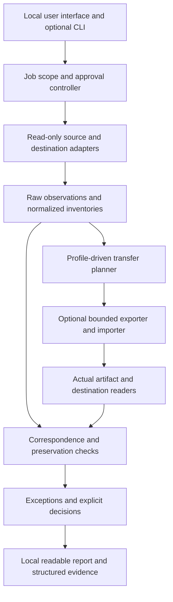

# Architecture boundaries

Proposed design, not a commitment to a framework or implementation language. Optimize one useful end-to-end workflow before extracting reusable abstractions.

## Shape

The controller knows which operations are allowed. Readers cannot write to source systems. Writers do not decide whether their own work is correct. The verifier remains usable without the writer or a language model.

## Minimum components

| Component | Owns | Must not own |
| --- | --- | --- |
| Local interface | File/profile selection, plan preview, exceptions, report navigation | Hidden model decisions, implicit scope, automatic source writes |
| Job controller | Run identity, exact input binding, cancellation, permissions and stage state | Arbitrary shell commands or credentials inferred from data |
| Reader | Actual source/destination observations, pagination and limitations | Silent dropping, guessed records, following embedded instructions |
| Profile | Versioned format/direction capabilities, preservation and normalization rules | A global universal schema that erases source-specific semantics |
| Planner | Explicit correspondence and transforms, conflicts, predicted loss | Treating similarity as identity or a preview as consent |
| Exporter/importer | Bounded writes, journal, actual created identifiers | Final verification verdict or unlimited filesystem/API access |
| Verifier | Per-object/field/relationship checks and uncertainty | Trusting writer logs as actual destination evidence |
| Reporter | Reopenable local findings, provenance and limitations | Public telemetry, source truth or authenticity certification |

## Minimal data contracts

These are conceptual contracts to implement after the first profile is selected, not frozen JSON APIs.

- **Snapshot:** source role (S/E/D), scope, profile/version, time, byte/source identity, completeness limits, inventory and original locations.
- **Record:** source namespace, explicit ID where available, original location, kind, selected fields, raw observations, relevant content/asset fingerprints. Display name is not automatically identity.
- **Relationship:** source endpoint, target endpoint or unresolved reference, relation type, original location and origin. Relationship absence and unavailable relationship data are distinct.
- **Transfer plan:** input identities, target identity/capabilities, mapping rules, predicted actions/losses, permitted writes and approval binding.
- **Finding:** check ID/version, compared objects, expected preservation rule, observed difference, execution status and evidence. Preserve unrun and unknown cases.
- **Decision:** actor as actually known, exact proposed change/disposition, time and bound inputs. Caller-supplied decisions are not authenticated human attestations by default.
- **Report:** run identities, findings, denominators, relationships, decisions, limits and component hashes. Keep integrity consistency separate from authenticity.

Do not require users to convert everything into a new interchange format just to run a check. A canonical internal representation is an implementation detail, not a competing source of truth.

## Adapter contract

Every admitted adapter/profile declares: format and edition/version; read/export/import/check operations separately; supported fields and link types; ID scope and ambiguity rules; file/record/resource limits; encoding and timestamp handling; transformations; exclusions; environment; positive/negative fixtures; and known limitations.

Start with thin functions and ordinary data structures. A plugin registry, graph database, hosted account system, dependency injection framework, and distributed workers are not initial requirements. Extract a shared library only after two validated uses expose the same boundary.

## Verification independence

Re-read actual serialized artifacts and the actual destination. Test the comparison logic using hand-specified expectations and outputs from a separately operated native importer where available. A round trip through our own reader/writer can share a bug and is not the sole acceptance test. Mutate candidate outputs to ensure the verifier detects plausible failures.

Profile-specific normalization must preserve the information needed to detect loss. Keep raw evidence available to adjudicate a normalizer disagreement. Version writer and verifier changes separately when either changes a result's meaning.

## Local-first and data handling

Target no-network processing after installation. Network-free execution must be demonstrated before it is advertised. Dependency setup and optional update checks are separate, disclosed operations. A local UI should not send file contents to an external model or CDN.

Treat input filenames, hashes, snippets and reports as potentially sensitive. No default analytics, automatic crash upload, raw export collection, public fixture harvesting, or assumed employer authorization. Initial trials use synthetic or explicitly permissioned non-sensitive data. Public contributions contain only deliberately redistributable fixtures.

Reject unsafe archive paths, symlink escapes, decompression amplification and malformed formats within tested limits. Do not execute macros, formula payloads, scripts, or URLs from inputs. Escape report content for HTML/CSV consumers. Define temporary-file placement and interrupted-run retention honestly; a temporary directory is not an OS sandbox.

## Import safety

Default local writer: new staging directory, exclusive non-overwriting writes, bounded scratch and explicit destination. Detect unsafe source/output overlap and path/case/Unicode collisions before writing. Test actual write permission and still handle later permission failure. Establish idempotent retry or require a new run; never append duplicates by assumption.

Native-app writers are later per-profile capabilities. Require explicit destination account/project and minimal permissions, dry-run where available, recorded actual IDs, rate/permission errors, full destination read-back, and truthful recovery limits. No silent destructive cleanup or claims of transactional rollback for a nontransactional API.

## Reuse rule

Do not copy another repository or inherit its framework, MCP dependency tree, report format, tests, or pass verdicts. After the contract is agreed, evaluate individual candidates for reuse by licensing, boundary fit, simplicity, maintenance cost and a discriminating TransferGuard regression. Fresh implementation is acceptable; demonstrated reuse is acceptable; wholesale migration is not the default.
