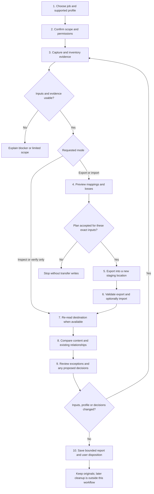
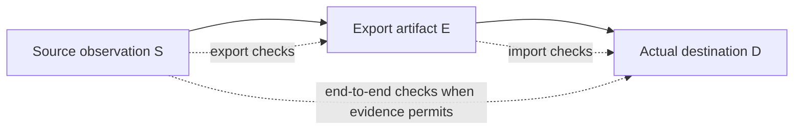

# End-to-end process map

Proposed process, not running software. Read with the [product contract](PRODUCT-SPEC.md) and [acceptance plan](TEST-AND-PILOT-PLAN.md).

## User journey

Step 5 is skipped when a supplied export is already the starting artifact. Step 6's import action is skipped for export-only mode. An inspect-only run does not require a destination and explicitly reports that destination checks did not run. These skips are recorded, not disguised as successful operations.

A report is a valid endpoint even when discrepancies remain. Activation of staged output is optional and separately approved; if activation changes the observed destination, re-read and recheck it before describing the live destination as verified.

## Evidence boundaries

A missing source observation limits the conclusion to the supplied export. A missing destination observation limits the result to export or import preparation. Verification must never substitute a generated manifest for independent source or destination observation.

## Completion criteria by step

### 1. Choose the job and supported profile

**Needs:** user's goal; operation (inspect, export, import, verify or combined); source/destination type; a versioned profile with declared reader/writer/check support.

**Produces:** a job definition containing the selected direction and supported operations.

**Complete when:** the user can state the intended result, and the software can identify an admitted profile. Unsupported formats get a concrete limitation or supported alternative, not silent conversion. Import support never automatically enables export.

**Do not proceed when:** the profile or intended boundary is ambiguous. File extensions alone are not sufficient format validation.

### 2. Confirm scope, authority and write boundary

**Needs:** authorized input locations; included records/folders/issue types; exclusions; intended destination; read-only or write grant; declared destination behavior.

**Produces:** explicit scope and permitted actions. Prefer choosing a known profile and folder over exposing technical mapping configuration.

**Complete when:** the user sees what will be included, what cannot be accessed, and whether any files or app records will be written. Inspect/verify is read-only except an explicitly selected new report.

**Do not proceed when:** ownership is unclear, source and output overlap unsafely, destructive behavior is required, or a write permission is absent. No source deletion is part of this workflow.

### 3. Capture stable evidence and build inventories

**Needs:** original bytes or a supported point-in-time source read, any supplied export, and destination evidence when it already exists.

**Produces:** inventories of records, fields, assets and source-explicit links; source locations; counts and identities; hashes where useful; filter/pagination/permission/consistency limits.

**Complete when:** every admitted member or record is enumerated or explicitly accounted for as unreadable/unsupported/excluded. Detect encoding problems, duplicate IDs, filename collisions, unsafe paths, truncated transfers and input limits. Capture the actual snapshot used by later steps.

**Do not proceed to a broad pass when:** pagination is incomplete, a source changes during capture, a parser stops early, an asset cannot be read, or a critical limit is exceeded. Return partial observations only with an unmistakable partial boundary. Hash the bytes actually consumed, not an earlier version at the same path.

### 4. Preview the mapping and likely losses

**Needs:** admitted input inventories, destination capabilities and preservation rules.

**Produces:** a dry-run plan: creates, path/ID rewrites, field transformations, supported relationship rewrites, collisions, unsupported fields, excluded items and expected differences. No destination transfer writes occur.

**Complete when:** the user can understand what will change, and unresolved identity/path conflicts block dependent writes. Material losses require a visible decision; a policy may block them entirely.

**Do not proceed when:** the plan relies on a fuzzy identity match, inaccessible target, silent overwrite or an unreviewed lossy transformation. Store plan identity so changed inputs invalidate prior approval.

### 5. Produce the export when requested

**Needs:** approved export plan for the exact source snapshot, a supported exporter, and a new permitted staging destination.

**Produces:** export bytes plus a source-to-export identity map and write journal. Prefer established native formats; a proprietary intermediary must not be mandatory to use the checker.

**Complete when:** all planned writes are accounted for, the finished export can be reopened, and the original source is unchanged. Interrupted work must not look complete.

**Do not proceed to import when:** disk space, permissions, cancellation, file collisions or serialization prevent a complete admitted export. Retain a useful failure report and leave pre-existing user data untouched.

**Skip:** supplied-export and verify-only runs do not fabricate a source-system export step.

### 6. Check the export; import only under its own approved plan

**Needs:** independently reopened export, source inventory where available, target profile, exact approved import plan, and write permission.

**Produces:** export-check findings; for import mode, a new staging destination or supported draft target and a journal mapping intended to actual IDs.

**Complete when:** required export checks have known outcomes and the importer has finished all planned writes or reported the exact partial boundary. Prefer object creation before relationship rewriting when target IDs are assigned at import.

**Do not proceed as successful when:** the export checker detects a required preservation failure, the target rejects records, only some pages import, or an ID/collision is unresolved. A target's success response is not destination verification.

**Recovery:** local tests must demonstrate retry behavior, no duplicate appends, and safe handling of abandoned staging. Remote rollback is not promised unless tested for that exact writer. An external native import can be user-operated; completion still requires step 7.

### 7. Observe the actual destination

**Needs:** completed staged/native import or an existing destination, a supported destination reader, and a stable observation window.

**Produces:** destination inventory read from disk, the real application interface, or its supported re-export. Record time, filters, permissions and any eventual-consistency delay.

**Complete when:** the destination inventory covers the declared scope and is linked to the actual result. Do not read the export again and call it destination data.

**Do not proceed to a complete verdict when:** the destination cannot be inspected, is stale, partially visible, or changed during observation. Report `DESTINATION_NOT_VERIFIED` or the narrower observed property. A staging-folder check does not verify a later application import.

### 8. Compare content, identity and existing relationships

**Needs:** frozen inventories, versioned comparison rules, admitted correspondence evidence, exclusions and expected transformations.

**Produces:** per-record/field/asset/edge findings, source and destination locations, and totals with visible denominators.

**Complete when:** every required check has an explicit outcome. Check missing-plus-duplicate cases, equal-count substitution, content loss hidden by normalization, attachment bytes and references, and links that resolve to the wrong target. Recognize expected one-to-many transformations. Attribute source defects separately from transfer-created defects.

**Do not report a broad pass when:** any required result is unavailable, ambiguous, failed or unrun. Self-contained hash agreement is not authenticity or semantic preservation. Shared parser bugs must be challenged by independently constructed expectations and external/consumer observations.

### 9. Review exceptions without rewriting history

**Needs:** actionable discrepancy view, actual source context, and optional narrowly scoped user decisions.

**Produces:** dispositions such as investigate, accept a known difference for this task, supply explicit identity correspondence, or leave unresolved. Keep original findings and prior report identity.

**Complete when:** the user can finish with unresolved questions and the report accurately distinguishes observed facts from supplied decisions. A decision that changes correspondence triggers affected checks again.

**Later feature:** advisory new-relationship candidates. No automatic semantic edges, no confirm-all, no claim that a tool call proves human approval. Ranking is not proof. A user cannot turn missing content into observed preservation by accepting a warning.

### 10. Save the report and record the user's next action

**Needs:** finished or explicitly partial observations, check outcomes, artifact/profile identities, decisions and known limitations.

**Produces:** a readable local report plus machine-readable findings, inventory summary, correspondence and relationship records, and hashes of report components. Report content may be sensitive and is not uploaded automatically.

**Complete when:** a new report is saved without overwriting earlier evidence, can be reopened, and matches the run's scope and actual outcomes. The user understands what was checked, what changed, and what remains unknown.

**Optional activation:** release staged output only with explicit permission and a defined operation; preserve the old destination. Reobserve changes caused by activation. Discrepancies can remain accepted-for-use but never be relabelled preserved.

**Outside the product:** deleting originals, silently cleaning up older runs, public sharing, telemetry, or declaring compliance. Retaining a report does not authorize any of those actions.

## Global stop and resume rule

At every stage: preserve source and pre-existing destination data, record failures, and invalidate stale approvals after material input/profile/target changes. A resumed run must prove it is continuing the same plan or become a new run. Never hide an interrupted step behind a completed summary.
